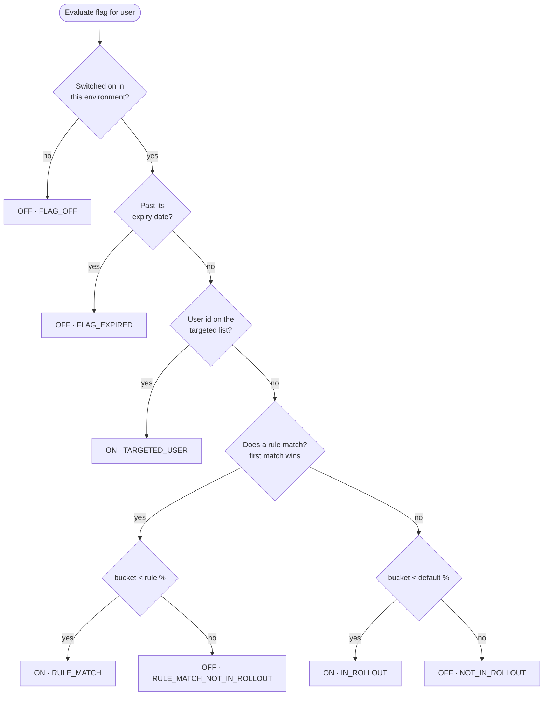
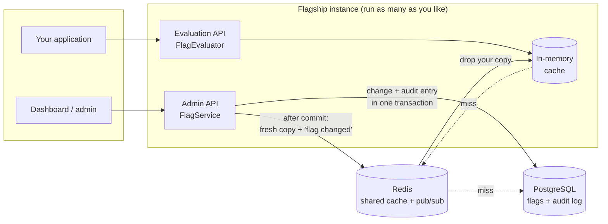
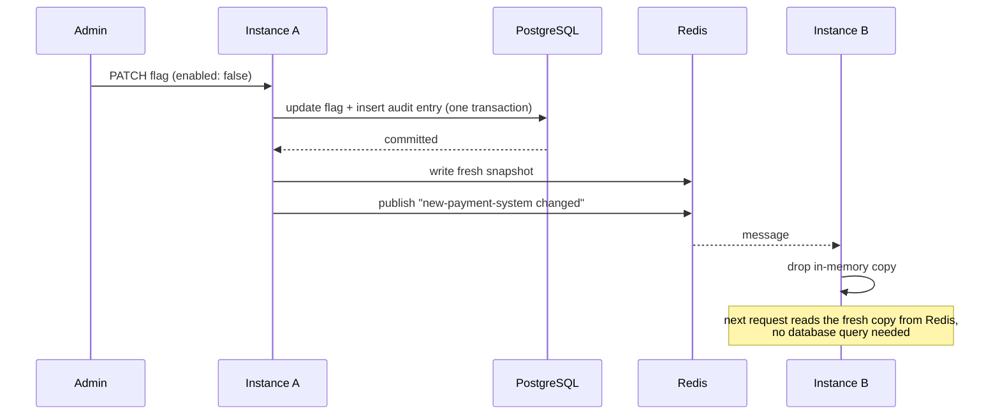

# Flagship

**Ship code dark, then turn features on for exactly the right users without redeploying.**

Flagship is a feature flag service written in Java 21 and Spring Boot. Each feature is wrapped in a flag. You decide
who gets the feature with targeting rules and percentage rollouts, and if something goes wrong you switch it off for
everyone within milliseconds.


| | |
|---|---|
| ⚡ **0.22 ms** median evaluation (p99 0.72 ms) | 🎯 Rules on any user attribute, with 9 operators |
| 🎲 Stable percentage rollouts (no flicker) | 🔁 Changes reach every instance on the next request |
| 🧾 Audit log with before/after state | ⏳ Temporary flags that switch themselves off |
| 🛡️ Keeps working when Redis is down | ✅ 55 tests, including against real Redis and PostgreSQL |

---

## Contents

- [Example: rolling out a new payment system](#example-rolling-out-a-new-payment-system)
- [Quick start](#quick-start)
- [How a flag is evaluated](#how-a-flag-is-evaluated)
- [Architecture](#architecture)
- [Performance](#performance)
- [API reference](#api-reference)
- [Configuration](#configuration)
- [Project layout](#project-layout)
- [Testing](#testing)
- [Design decisions](#design-decisions)
- [Roadmap](#roadmap)

---

## Example: rolling out a new payment system

Your team has built a new payment flow. Releasing it to every customer at once is risky, so you release it in stages:

| Stage | Who gets the new flow | How |
|---|---|---|
| 1 | Your QA team only | targeted user ids |
| 2 | 10% of premium users in India | rule `plan = premium AND country = IN` at 10% |
| 3 | All premium users in India | raise the rule to 100% |
| 4 | Everyone | default rollout 100% |
| 🚨 | Something breaks? Nobody, instantly | `"enabled": false` |

Your application asks one question per request:

```http
POST /api/evaluate
{
  "flagKey": "new-payment-system",
  "environment": "PROD",
  "user": { "id": "user-42", "attributes": { "plan": "premium", "country": "IN" } }
}
```

and gets back the answer **and the reason**:

```json
{ "flagKey": "new-payment-system", "environment": "PROD", "userId": "user-42",
  "enabled": true, "reason": "RULE_MATCH", "ruleIndex": 0 }
```

The `reason` field means a question like "why can't this customer see the new checkout?" can be answered from the response alone.

---

## Quick start

**Requirements:** Java 21. Docker is only needed for the full setup.

```bash
git clone https://github.com/kn2901/flagship.git
cd flagship
./mvnw spring-boot:run          # starts on http://localhost:8080 with an embedded H2 database
```

**Full setup with PostgreSQL and Redis:**

```bash
docker compose up -d
./mvnw spring-boot:run -Dspring-boot.run.profiles=docker
```

**Try it in 30 seconds:**

```bash
# 1. Create a flag (it starts OFF in every environment)
curl -X POST localhost:8080/api/flags -H 'Content-Type: application/json' \
  -d '{"key": "new-payment-system", "name": "New payment system"}'

# 2. Turn it on in PROD for premium users in India
curl -X PATCH localhost:8080/api/flags/new-payment-system/environments/PROD \
  -H 'Content-Type: application/json' -d '{
    "enabled": true, "rolloutPercentage": 0,
    "rules": [{ "description": "Premium users in India",
                "conditions": [ {"attribute": "plan",    "operator": "IN", "values": ["premium"]},
                                {"attribute": "country", "operator": "IN", "values": ["IN"]} ],
                "rolloutPercentage": 100 }]
  }'

# 3. Ask whether a user gets the feature
curl -X POST localhost:8080/api/evaluate -H 'Content-Type: application/json' \
  -d '{"flagKey": "new-payment-system", "environment": "PROD",
       "user": {"id": "user-42", "attributes": {"plan": "premium", "country": "IN"}}}'
```

---

## How a flag is evaluated

The checks run top to bottom, and the first one that applies decides the result:



### Rules

A rule matches when **all** of its conditions match. Each condition compares one user attribute
(`userId` is always available) with a list of values:

| Operator | Matches when the attribute… | Example |
|---|---|---|
| `IN` / `NOT_IN` | equals one / none of the values | `country IN [IN, LK]` |
| `CONTAINS` | contains one of the values | `email CONTAINS [@acme.com]` |
| `STARTS_WITH` / `ENDS_WITH` | starts / ends with one of the values | `userId STARTS_WITH [employee-]` |
| `GREATER_THAN`, `GREATER_THAN_OR_EQUAL`, `LESS_THAN`, `LESS_THAN_OR_EQUAL` | compares as a number | `accountAgeDays GREATER_THAN [30]` |

A user who doesn't have the attribute never matches, not even `NOT_IN`. So `country NOT_IN [IN]` won't quietly
include users whose country is unknown.

### Stable percentage rollouts

Picking "10% of users" at random on each request would make the feature flicker on and off for the same person.
Instead, every user gets a fixed bucket from 0 to 99 for each flag:

```java
bucket  = floorMod(first4Bytes(sha256(flagKey + ":" + userId)), 100);
enabled = bucket < rolloutPercentage;
```

- **The same user always gets the same answer.**
- **Each flag picks a different 10%**, because the flag key is part of the hash, so the same users aren't the test group for every experiment.
- **Raising a percentage only adds users.** At 10%, buckets 0–9 are in; at 20%, buckets 0–19 are. Nobody loses the feature.

Tests check this over 100,000 users: a 10% rollout lands between 9.5% and 10.5%, and raising a percentage never removes anyone.

---

## Architecture



The evaluation path never opens a database transaction or touches JPA entities. It evaluates an immutable
`FlagSnapshot` with a pure function, and the snapshot comes from a three-level cache:

| Level | Where | Used for |
|---|---|---|
| 1 | In-memory map in each instance | almost every request (~nanoseconds) |
| 2 | Redis, shared by all instances | after a restart or a change |
| 3 | PostgreSQL | only when Redis doesn't have it |

### What happens when a flag changes



### Keeping the cache correct

- **Only committed changes are cached.** Cache updates run after the transaction commits (`@TransactionalEventListener(AFTER_COMMIT)`), so a rolled-back change is never cached.
- **Staleness has a limit.** In-memory entries also expire after 30s, in case a pub/sub message is ever lost.
- **One database read per burst.** When many requests miss the cache for the same flag at once, they share a single database read (request coalescing).
- **No stale write-back.** A read that started before a change isn't allowed to store its now-outdated result.
- **Typos can't flood the database.** Unknown flag keys are remembered as "not found" for 5s.

### When Redis fails

- Every Redis call has a 200 ms timeout and **never throws**. A failure is treated as a cache miss, and the service reads from PostgreSQL.
- A **circuit breaker** skips Redis for 5s after a failure, so requests go straight to the database instead of each waiting for a timeout.
- Flags that change during an outage are remembered and **cleared from Redis once it's back**, so Redis can't keep serving a config from before the outage.

---

## Performance

Measured on a 2-core cloud VM that was running two Flagship instances, PostgreSQL, Redis and the load generator at the same time:

| Measurement | Result |
|---|---|
| `POST /api/evaluate`, end-to-end over HTTP, 20,000 requests | **p50 0.22 ms · p95 0.48 ms · p99 0.72 ms** |
| Throughput with 10 concurrent connections | ~19,000 requests/s |
| Lookups answered from memory during the load test | 516,757 of 516,765 (4 from Redis, 4 from PostgreSQL) |
| Change on instance A, seen by instance B | on the next request, with no database query on B |
| Uncached lookup while Redis is down | first: 0.76 s (timeout, then the breaker opens); after that: ~10 ms from PostgreSQL |

Cache sources are exposed as a metric: `GET /actuator/metrics/featureflags.cache.lookups?tag=source:memory` (also `redis`, `database`).

---

## API reference

| Method | Endpoint | What it does |
|---|---|---|
| `POST` | `/api/flags` | Create a flag (off in every environment) |
| `GET` | `/api/flags` | List all flags |
| `GET` | `/api/flags/{key}` | Get one flag with all environments |
| `PATCH` | `/api/flags/{key}` | Change name, description or expiry |
| `PATCH` | `/api/flags/{key}/environments/{env}` | Change on/off, %, targeted users or rules |
| `DELETE` | `/api/flags/{key}` | Delete a flag |
| `POST` | `/api/evaluate` | Evaluate for a user with attributes |
| `GET` | `/api/evaluate?flagKey=&environment=&userId=` | Quick evaluation by user id only |
| `GET` | `/api/flags/{key}/audit-logs` | Change history of one flag, newest first |
| `GET` | `/api/audit-logs?page=&size=` | Change history of all flags |
| `GET` | `/actuator/health`, `/actuator/metrics` | Health and metrics |

Environments are `DEV`, `STAGING` and `PROD`. Admin requests can send an `X-Actor` header naming who made the change; it's recorded in the audit log.

<details>
<summary><b>More examples</b>: expiry, targeted users, audit log</summary>

```bash
# A temporary flag that switches itself off on 15 November
curl -X POST localhost:8080/api/flags -H 'Content-Type: application/json' \
  -d '{"key": "diwali-banner", "name": "Diwali banner", "expiresAt": "2026-11-15T00:00:00Z"}'

# Extend it, or remove the expiry
curl -X PATCH localhost:8080/api/flags/diwali-banner -H 'Content-Type: application/json' \
  -d '{"expiresAt": "2026-11-20T00:00:00Z"}'
curl -X PATCH localhost:8080/api/flags/diwali-banner -H 'Content-Type: application/json' \
  -d '{"removeExpiry": true}'

# QA testers always get the feature, everyone else 5%
curl -X PATCH localhost:8080/api/flags/new-payment-system/environments/STAGING \
  -H 'Content-Type: application/json' -H 'X-Actor: priya' \
  -d '{"enabled": true, "rolloutPercentage": 5, "targetedUsers": ["qa-1", "qa-2"]}'

# Who changed what
curl localhost:8080/api/flags/new-payment-system/audit-logs
```

A single audit entry:

```json
{
  "id": 2, "flagKey": "new-payment-system", "action": "ENVIRONMENT_UPDATED",
  "environment": "STAGING", "actor": "priya", "createdAt": "2026-11-10T08:15:02Z",
  "before": { "enabled": false, "rolloutPercentage": 100, "targetedUsers": [], "rules": [] },
  "after":  { "enabled": true,  "rolloutPercentage": 5,   "targetedUsers": ["qa-1", "qa-2"], "rules": [] }
}
```

Errors always have the same shape, for example `{"status": 400, "message": "rolloutPercentage must be between 0 and 100"}`.

</details>

---

## Configuration

| Property | Default | Meaning |
|---|---|---|
| `featureflags.redis.enabled` | `false` (`true` in the `docker` profile) | Use Redis as the shared cache and change channel |
| `featureflags.cache.local-ttl` | `30s` | Longest an instance trusts its in-memory copy |
| `featureflags.cache.negative-ttl` | `5s` | How long an unknown flag key is remembered |
| `featureflags.cache.redis-ttl` | `10m` | How long a flag stays in Redis |
| `featureflags.expiry-check-interval-ms` | `60000` | How often the expiry job runs |
| `spring.data.redis.timeout` | `200ms` | Redis timeout before falling back to the database |

---

## Project layout

```
src/main/java/com/example/featureflags
├── evaluation/   the decision engine: pure Java, no I/O
│                 FlagEvaluator, ConditionMatcher, RolloutHasher, FlagSnapshot
├── cache/        FlagCache (memory → Redis → DB), Redis cache + pub/sub listener
├── service/      FlagService (admin), EvaluationService (hot path), AuditService, FlagExpiryJob
├── controller/   REST endpoints
├── model/        JPA entities: Flag, FlagEnvironment, AuditLog, TargetingRule, Condition
├── dto/          request/response records with validation
└── exception/    one JSON error format for every failure
src/main/resources/db/migration   Flyway schema (runs on PostgreSQL and H2)
```

---

## Testing

```bash
./mvnw test                                                   # 53 tests, nothing to install
docker compose up -d && INTEGRATION_TESTS=true ./mvnw test    # + 2 against real PostgreSQL and Redis
```

| Test class | What it proves |
|---|---|
| `FlagEvaluatorTest` | evaluation order, first matching rule wins, "premium users in India at 10%" really reaches ~10%, raising a % never removes a user |
| `ConditionMatcherTest` | every operator, missing attributes, non-numeric values |
| `RolloutHasherTest` | stable buckets, even distribution over 100k users, independent groups per flag |
| `FlagCacheTest` | caching, negative caching, TTL, eviction, 16 concurrent misses sharing one load |
| `FlagApiTest` | the whole HTTP API, validation, cache invalidation, audit entries, and expiry with a controllable clock |
| `RedisPostgresIntegrationTest` | snapshots written to Redis after commit, changes from "another instance" picked up via pub/sub |

---

## Design decisions

| Decision | Why |
|---|---|
| Rules stored as one JSON column | Rules are always read and written as a complete ordered list, so separate rules/conditions tables would only add joins. |
| Audit entry in the same transaction as the change (`Propagation.MANDATORY`) | A change can never be saved without its audit entry. |
| Audit rows store the flag key, not a foreign key | History survives the flag being deleted. |
| Expiry checked both when evaluating and by a scheduled job | Expired flags are off immediately, and the stored state and audit log still record that they were switched off. |
| Evaluator is a pure function over an immutable snapshot | Easy to unit test, thread-safe without locks, and no database work on the hot path. |
| Flyway owns the schema; Hibernate only validates it | One versioned migration that runs on both PostgreSQL and H2. |
| Service runs in UTC | Consistent timestamps, and PostgreSQL won't reject legacy zone names such as `Asia/Calcutta`. |

---

## Roadmap

- [ ] API keys per environment (an SDK key can only evaluate; an admin key can change flags)
- [ ] Java client SDK that keeps flags in the application's memory and receives live updates over Server-Sent Events
- [ ] Batch evaluation of all flags for one user (for frontends)
- [ ] Web dashboard
- [ ] Distributed lock (ShedLock) for the expiry job when running many instances
